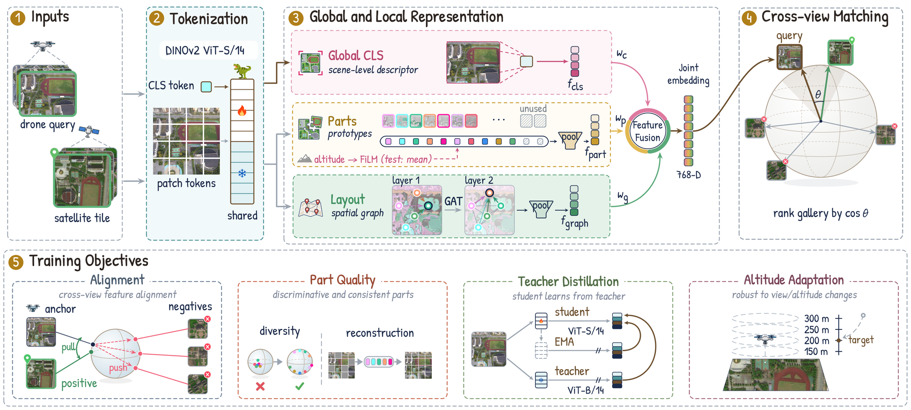

<div align="center">

# SkyPart

### Weather-Robust Cross-View Geo-Localization via Prototype-Based Semantic Part Discovery

**Chi-Nguyen Tran**<sup>1,2*</sup>, **Duy-Minh Dao-Sy**<sup>1,2*</sup>, **Trung-Kiet Huynh**<sup>1,2*</sup>, **Phu-Hoa Pham**<sup>1,2</sup>, **Phu-Quy Nguyen-Lam**<sup>1,2</sup>, **Long Tran-Thanh**<sup>3</sup>

<sup>1</sup>Faculty of Information Technology, University of Science, Ho Chi Minh City, Vietnam &nbsp;&nbsp; <sup>2</sup>Vietnam National University, Ho Chi Minh City, Vietnam<br><sup>3</sup>Department of Computer Science, University of Warwick, Coventry, United Kingdom &nbsp;&nbsp; <sup>*</sup>Equal contribution

[](https://chisngyen.github.io/SkyPart/)
[](https://arxiv.org/abs/2605.11654)
[](https://openreview.net/forum?id=wxPKGRCVh8)
[](https://openreview.net/forum?id=wxPKGRCVh8)
[](LICENSE)



</div>

## News

- **2026-09**: SkyPart is accepted to **NeurIPS 2026**.

## Overview

SkyPart is a lightweight head for patch-based vision transformers that matches drone views to satellite tiles through explicit part grouping. Learnable prototypes compete for patch tokens, altitude-conditioned FiLM is used only during training so the retrieval embedding needs no altitude at inference, a graph-attention readout encodes how the parts are arranged, and a Kendall uncertainty-weighted loss learns the loss-group weights end to end.

## Results

Single 448×448 forward pass, no re-ranking, no test-time augmentation. DINOv2 ViT-S/14, 26.95 M parameters, 22.14 GFLOPs.

**SUES-200** (R@1 / AP, %, full 200-tile gallery)

| Direction | 150 m | 200 m | 250 m | 300 m | Mean R@1 |
|---|:---:|:---:|:---:|:---:|:---:|
| Drone → Satellite | 97.25 / 97.90 | 98.75 / 99.33 | 99.30 / 99.64 | 99.60 / 99.77 | 98.725 |
| Satellite → Drone | 100.00 / 97.36 | 100.00 / 97.95 | 100.00 / 99.98 | 100.00 / 99.95 | 100.00 |

Three-seed mean Drone → Satellite R@1: 98.74 ± 0.11.

**University-1652** (%)

| D→S R@1 | D→S AP | S→D R@1 | S→D AP |
|:---:|:---:|:---:|:---:|
| 96.47 | 97.77 | 98.43 | 98.24 |

**DenseUAV** (%)

| R@1 | R@5 | SDM@1 |
|:---:|:---:|:---:|
| 91.85 | 97.81 | 93.59 |

**Weather robustness** (Drone → Satellite R@1, %, ten WeatherPrompt conditions, clean satellite gallery, 392×392)

| Dataset | Normal | Fog | Rain | Snow | Fog+Rain | Fog+Snow | Rain+Snow | Dark | Over-exp. | Wind | Mean |
|---|:---:|:---:|:---:|:---:|:---:|:---:|:---:|:---:|:---:|:---:|:---:|
| SUES-200 | 97.21 | 96.27 | 96.06 | 95.33 | 94.71 | 90.44 | 95.17 | 92.06 | 93.34 | 96.54 | 94.71 |
| University-1652 | 95.15 | 93.78 | 93.44 | 92.05 | 90.05 | 88.51 | 89.47 | 83.26 | 88.23 | 89.68 | 90.36 |
| DenseUAV | 91.25 | 90.13 | 91.38 | 90.35 | 89.79 | 87.69 | 91.12 | 84.64 | 90.18 | 91.76 | 89.83 |

## Datasets

| Dataset | Source |
|---|---|
| SUES-200 | [Reza-Zhu/SUES-200-Benchmark](https://github.com/Reza-Zhu/SUES-200-Benchmark) |
| University-1652 | [layumi/University1652-Baseline](https://github.com/layumi/University1652-Baseline) |
| DenseUAV | [Dmmm1997/DenseUAV](https://github.com/Dmmm1997/DenseUAV) |

Setup, data layout and commands: [docs/REPRODUCE.md](docs/REPRODUCE.md), [docs/DATA.md](docs/DATA.md).

## Citation

```bibtex
@inproceedings{skypart2026,
  title     = {Weather-Robust Cross-View Geo-Localization via Prototype-Based Semantic Part Discovery},
  author    = {Chi-Nguyen Tran and Duy-Minh Dao-Sy and Trung-Kiet Huynh and Phu-Hoa Pham and Phu-Quy Nguyen-Lam and Long Tran-Thanh},
  booktitle = {Advances in Neural Information Processing Systems (NeurIPS)},
  year      = {2026}
}
```

## Acknowledgements

We thank the anonymous reviewers and the area chair for their constructive feedback, which improved this paper, and Realtime Robotics for discussions on real-world robot deployment that motivated the problem studied here. All experiments were run on the free GPU quota provided by Kaggle. This work received no external funding, and the authors declare no competing interests.

## License

This project is released under the [MIT License](LICENSE). The datasets and the DINOv2 weights are subject to their own licenses.
